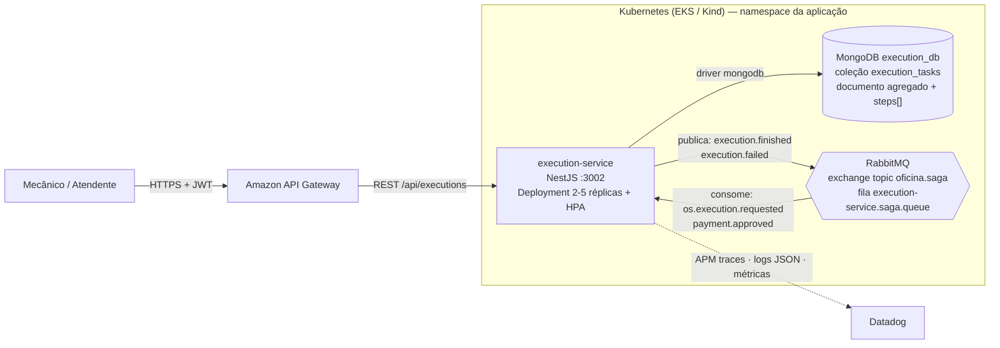
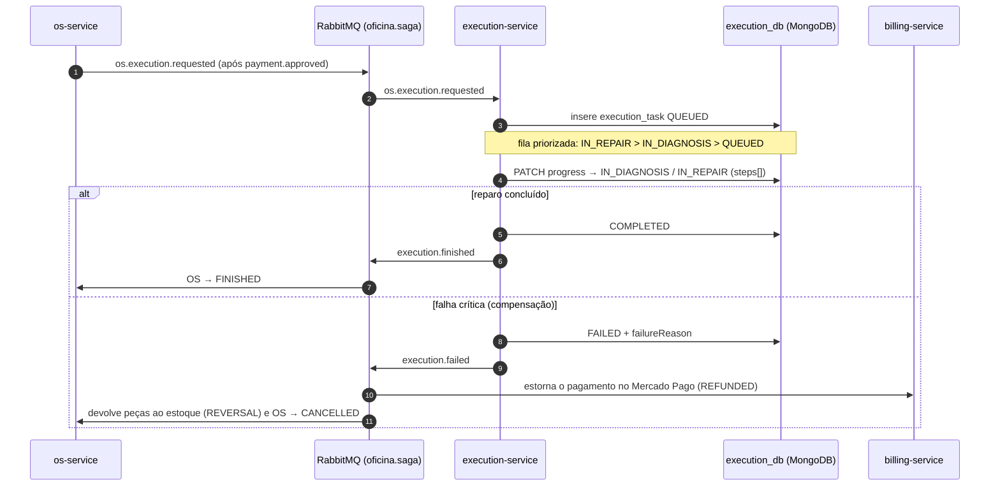
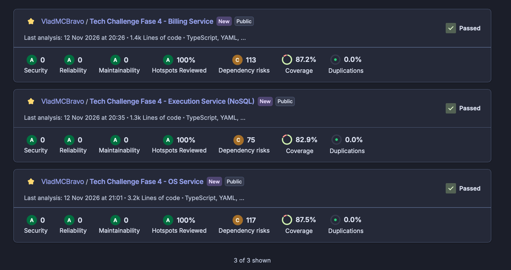
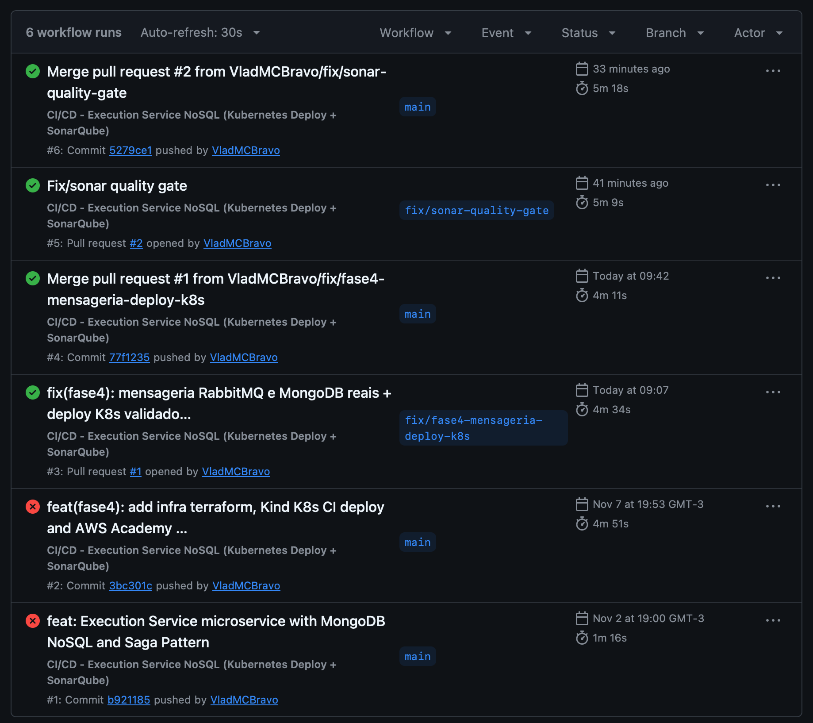
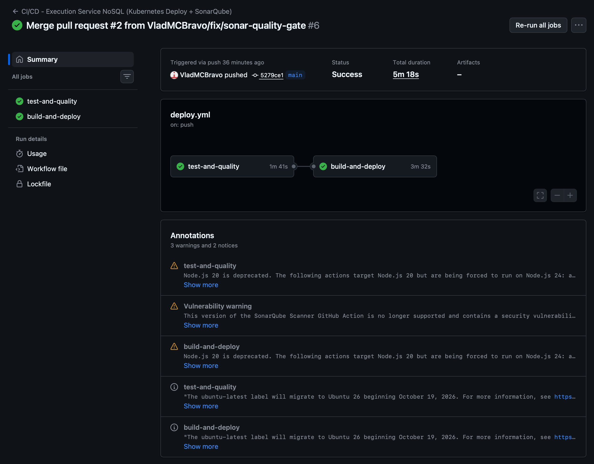
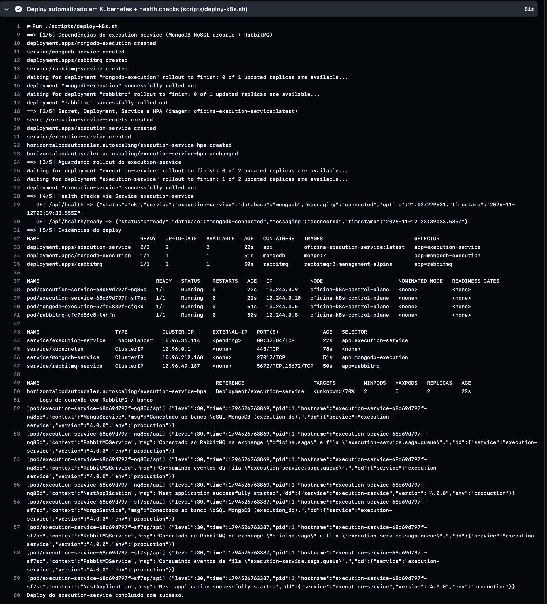

# Tech Challenge Fase 4 — Execution Service (`tech-challenge-fase4-execution-service`)

Microsserviço responsável pelo gerenciamento da **Fila de Execução e Produção da Oficina**, acompanhamento de etapas de diagnóstico e reparo em **banco de dados NoSQL (MongoDB)** e comunicação de conclusão ou falha crítica via **Saga Pattern Coreografado**.

- **Participante:** Vladmir Musa Costa Bravo (RM 374193)
- **Curso:** Pós-graduação em Arquitetura de Software — FIAP (SOAT)

---

## Arquitetura do serviço

### Componentes


### Participação na Saga coreografada


---

## 1. Justificativa do Banco NoSQL (MongoDB — `execution_db`) e Infra Isolada

O `execution-service` utiliza **MongoDB (NoSQL orientado a documentos)** pela natureza semiestruturada e orientada a eventos do chão de oficina:
- Cada tarefa de execução (`execution_tasks`) armazena em um **único documento agregado** a lista de serviços, peças planejadas e um array dinâmico de etapas/apontamentos do mecânico (`steps: [{ stage, description, mechanicName, timestamp }]`).
- Leituras da fila priorizada (`IN_REPAIR > IN_DIAGNOSIS > QUEUED`) e gravações de progresso ocorrem com **baixa latência e sem necessidade de JOINs**.
- **Infraestrutura Terraform Própria (`/infra`) e Manifestos K8s (`/k8s`):** Provisionamento isolado do repositório ECR e do cluster NoSQL (`execution_db`), sem compartilhamento de banco com os demais microsserviços.

---

## 2. Participação no Saga Pattern (Coreografado via RabbitMQ)

1. **Consumo de `os.execution.requested` / `payment.approved`:** Assim que o pagamento é confirmado e a OS entra em execução, o `execution-service` insere automaticamente o documento na coleção `execution_tasks` do MongoDB com status `QUEUED`.
2. **Evolução Interna (`IN_DIAGNOSIS` / `IN_REPAIR`):** O mecânico registra apontamentos na tarefa via `PATCH /api/executions/work-order/:workOrderId/progress`.
3. **Publicação de `execution.finished` (Fluxo Feliz):** Ao concluir os reparos (`PATCH /api/executions/work-order/:workOrderId/finish`), o serviço atualiza o documento no MongoDB para `COMPLETED` e publica `execution.finished`, permitindo que o `os-service` marque a OS como `FINISHED`.
4. **Publicação de `execution.failed` (Gatilho de Rollback Distribuído):** Caso ocorra falha técnica impeditiva (`PATCH /api/executions/work-order/:workOrderId/fail`), o documento é marcado como `FAILED` e o evento `execution.failed` é publicado no RabbitMQ:
   - O `billing-service` consome o evento e **estorna o pagamento no Mercado Pago (`REFUNDED`)**;
   - O `os-service` consome o evento, **devolve as peças reservadas ao estoque (`REVERSAL`)** e cancela a OS (`CANCELLED`).

---

## 3. Evidências de Testes e Cobertura (`> 80%`)

```text
PASS src/executions/executions.service.spec.ts
    ✓ deve enfileirar uma OS na coleção NoSQL (MongoDB) via evento Saga os.execution.requested
    ✓ deve enfileirar via fallback de payment.approved se ainda não existir na fila
    ✓ deve ordenar a fila de execução por prioridade de status (IN_REPAIR > IN_DIAGNOSIS > QUEUED) e excluir COMPLETED/FAILED
    ✓ deve concluir a execução no MongoDB e publicar o evento Saga execution.finished
    ✓ deve registrar falha na execução e publicar o evento Saga execution.failed para acionar compensação/rollback
    ✓ deve validar erros ao buscar ou modificar execuções inexistentes ou já encerradas
    ✓ deve exercitar operações com driver de coleção MongoDB e canal RabbitMQ conectados
PASS src/messaging/rabbitmq.service.spec.ts
    ✓ modo in-memory > não conecta ao broker sem RABBITMQ_URL e registra eventos publicados
    ✓ modo in-memory > despacha eventos para todos os handlers registrados
    ✓ com RabbitMQ real > cria exchange/fila, faz bind das routing keys e só consome após o bootstrap
    ✓ com RabbitMQ real > processa a mensagem no handler e confirma (ack)
    ✓ com RabbitMQ real > rejeita (nack) mensagens inválidas ou cujo handler falha
    ✓ com RabbitMQ real > publica eventos persistentes na exchange da Saga
    ✓ com RabbitMQ real > registra erro quando a publicação no canal falha
    ✓ com RabbitMQ real > reconecta automaticamente quando o broker ainda não está disponível
    ✓ com RabbitMQ real > reconecta quando a conexão é encerrada e para ao desligar
    ✓ com RabbitMQ real > cancela a reconexão pendente ao desligar

------------------------|---------|----------|---------|---------|--------------------
File                    | % Stmts | % Branch | % Funcs | % Lines | Uncovered Line #s  
------------------------|---------|----------|---------|---------|--------------------
All files               |   88.08 |    79.76 |   94.33 |   90.15 |                    
 database               |   67.56 |    65.62 |   76.92 |   70.14 |                    
 executions             |   94.59 |    79.22 |     100 |    97.1 |                    
 messaging              |   98.14 |    90.19 |     100 |     100 |                    
 observability          |   85.71 |       75 |     100 |   84.21 |                    
------------------------|---------|----------|---------|---------|--------------------
Test Suites: 2 passed, 2 total
Tests:       17 passed, 17 total
```

---

## 4. CI/CD, Deploy Automatizado em Kubernetes e Nota sobre AWS Academy

Pipeline: [`.github/workflows/deploy.yml`](./.github/workflows/deploy.yml) — disparado automaticamente em `push` e `pull_request` na `main` (e `workflow_dispatch`). A `main` é protegida: o merge só acontece via Pull Request com os dois jobs abaixo aprovados.

| Job | O que faz |
|---|---|
| `test-and-quality` | `npm ci` → testes unitários com cobertura (`npm run test:cov`) → build → análise SonarQube/SonarCloud |
| `build-and-deploy` | build da imagem Docker → cria cluster Kubernetes **Kind** → instala o metrics-server (HPA) → executa [`scripts/deploy-k8s.sh`](./scripts/deploy-k8s.sh) |

O script [`scripts/deploy-k8s.sh`](./scripts/deploy-k8s.sh) faz o deploy completo e **falha o pipeline** se algo não subir:
1. Sobe as dependências próprias do serviço — `k8s/mongodb.yaml` (MongoDB `execution_db`) e `k8s/rabbitmq.yaml` (broker da Saga) — e espera ficarem prontas;
2. Aplica `secret.yaml`, `deployment.yaml`, `service.yaml` e `hpa.yaml`;
3. Espera o `kubectl rollout status` do `execution-service` (2 réplicas Ready);
4. Testa os health checks pelo Service: `GET /api/health` e `GET /api/health/ready` (banco **e** RabbitMQ conectados — `"messaging":"connected"`);
5. Imprime as evidências: deployments, pods, services, HPA e logs de conexão com o RabbitMQ.

Para rodar localmente contra qualquer cluster (ex.: Kind): `kind create cluster && docker build -t oficina-execution-service:latest . && kind load docker-image oficina-execution-service:latest && ./scripts/deploy-k8s.sh`.

**Nota sobre o AWS Academy:** as sessões do laboratório expiram e os créditos são limitados, então — conforme orientação dos professores — o deploy automatizado do pipeline é feito em Kubernetes local (**Kind**) dentro do próprio GitHub Actions, com manifests, script de deploy e evidências de pods/services/health checks nos logs de cada execução. Os mesmos manifestos são aplicáveis no Amazon EKS provisionado pelo Terraform (`/infra` e repositório `tech-challenge-fase3-infra-k8s`); nesse caso o `DATABASE_URL`/`MONGODB_URI` do Secret aponta para o banco gerenciado.

---

## 5. Principais Endpoints e Execução

- `GET /api/executions/queue` — Lista fila ativa ordenada por prioridade (`IN_REPAIR > IN_DIAGNOSIS > QUEUED` + FIFO)
- `GET /api/executions/work-order/:workOrderId` — Consulta documento NoSQL e histórico de apontamentos da OS
- `PATCH /api/executions/work-order/:workOrderId/progress` — Atualiza etapa/progresso do mecânico
- `PATCH /api/executions/work-order/:workOrderId/finish` — Finaliza reparo e publica `execution.finished`
- `PATCH /api/executions/work-order/:workOrderId/fail` — Registra falha crítica e publica `execution.failed` (Rollback Saga)
- **Swagger:** `http://localhost:3002/docs`

```bash
npm ci
npm run test:cov
npm run start:dev
```

---

## 6. Evidências (SonarCloud, CI/CD e Deploy)

### Qualidade de código — SonarCloud (Quality Gate aprovado nos 3 microsserviços)
Análise executada pelo próprio pipeline (`sonarqube-scan-action` com Quality Gate bloqueante), com cobertura importada do `lcov.info` do Jest.



### Pipeline CI/CD — execuções automáticas em Pull Request e em merge na `main`
Todas as alterações entram na `main` via Pull Request (branch protegida); o pipeline roda no PR e novamente após o merge.



### Pipeline da `main` — `test-and-quality` → `build-and-deploy`
`test-and-quality`: testes com cobertura mínima de 80%, build e SonarCloud. `build-and-deploy`: imagem Docker, cluster Kubernetes (Kind), deploy via [`scripts/deploy-k8s.sh`](./scripts/deploy-k8s.sh) e health checks.



### Deploy automatizado em Kubernetes (Kind) com health checks
Log da etapa `scripts/deploy-k8s.sh` no pipeline: dependências próprias (MongoDB `execution_db` + RabbitMQ) prontas, rollout das 2 réplicas do `execution-service`, health checks (`/api/health` e `/api/health/ready` com banco e mensageria conectados), deployments/pods/services/HPA e logs JSON de conexão ao RabbitMQ.


